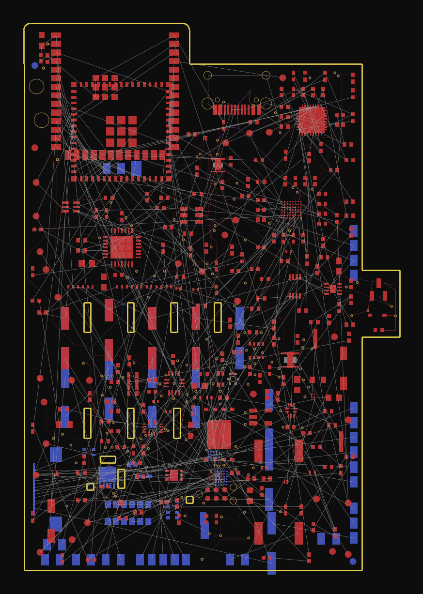
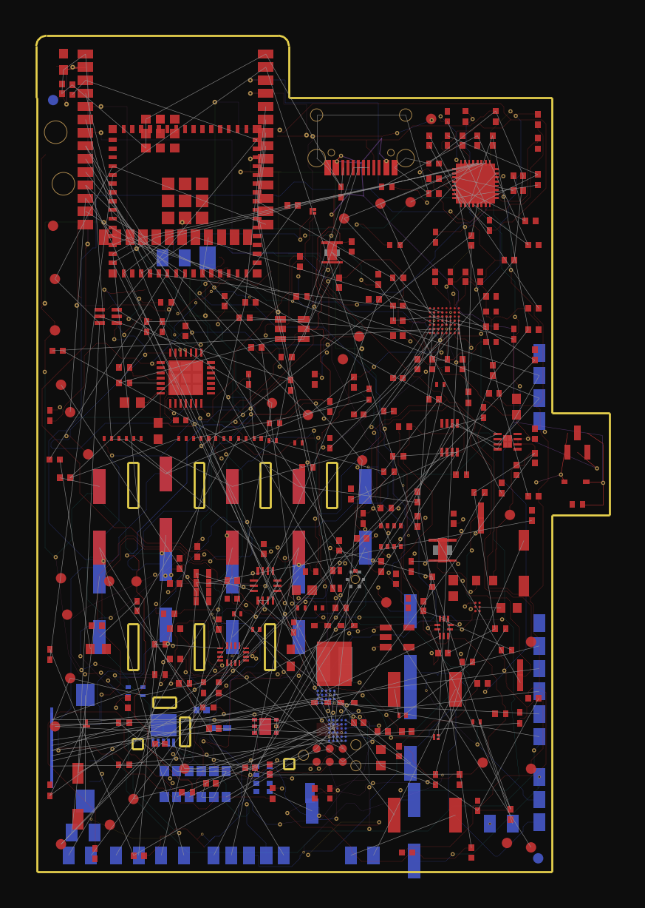
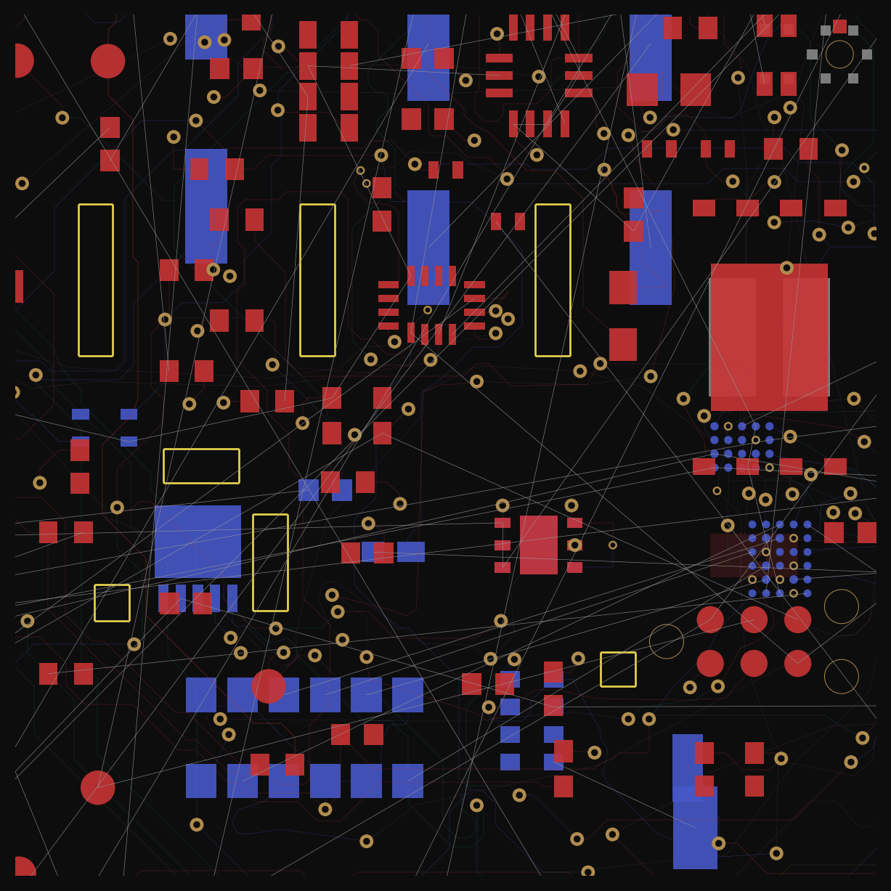
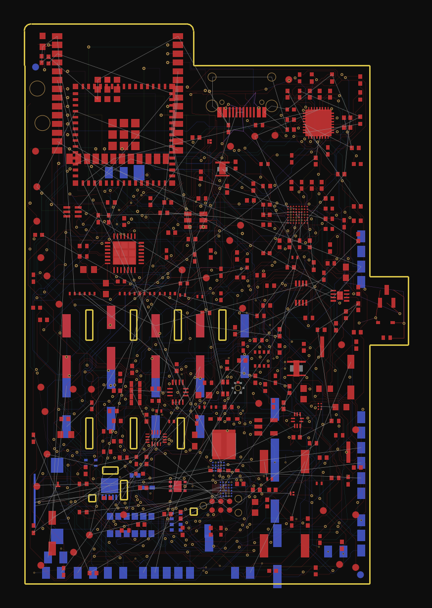
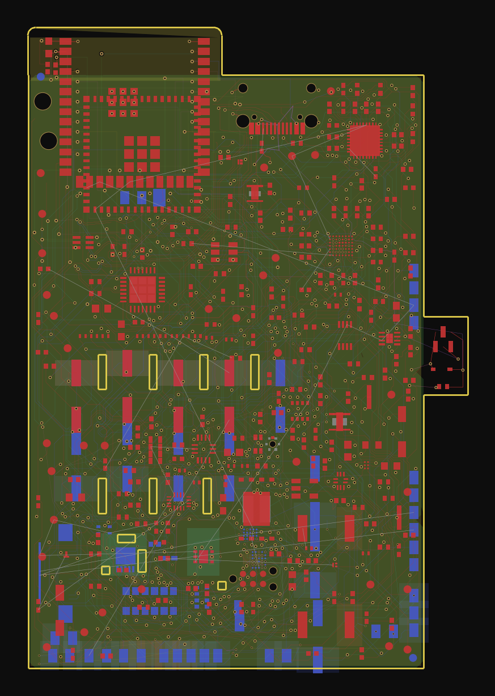
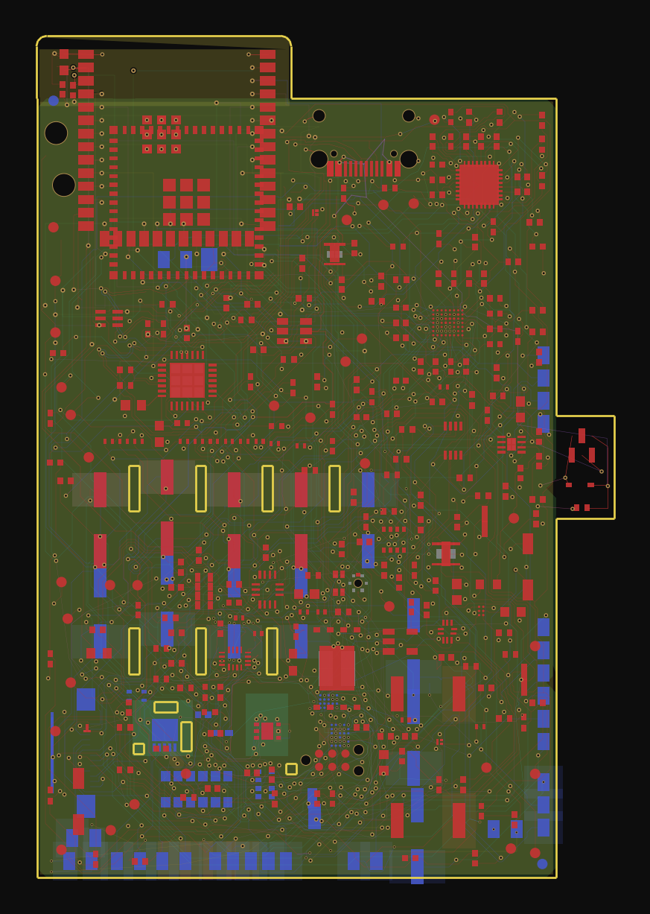
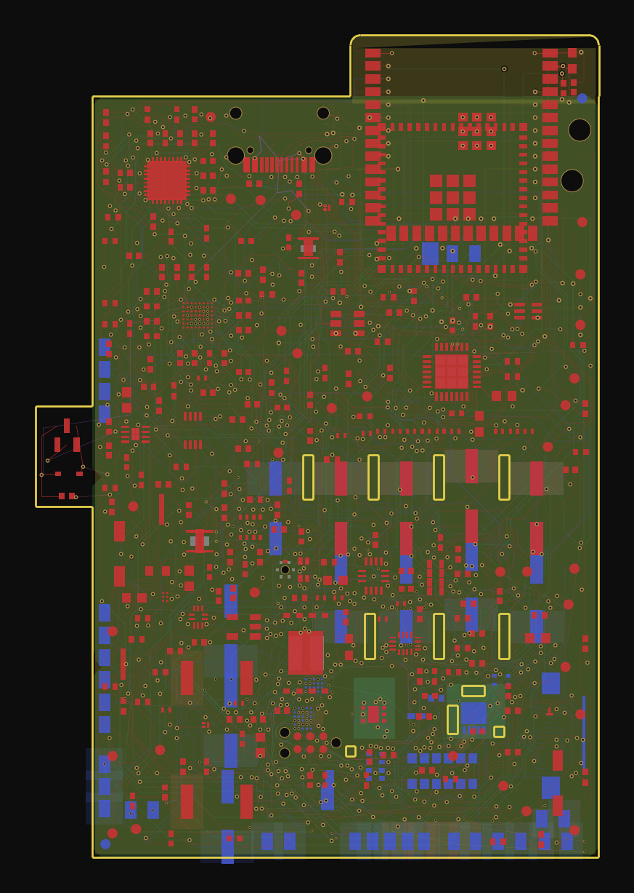
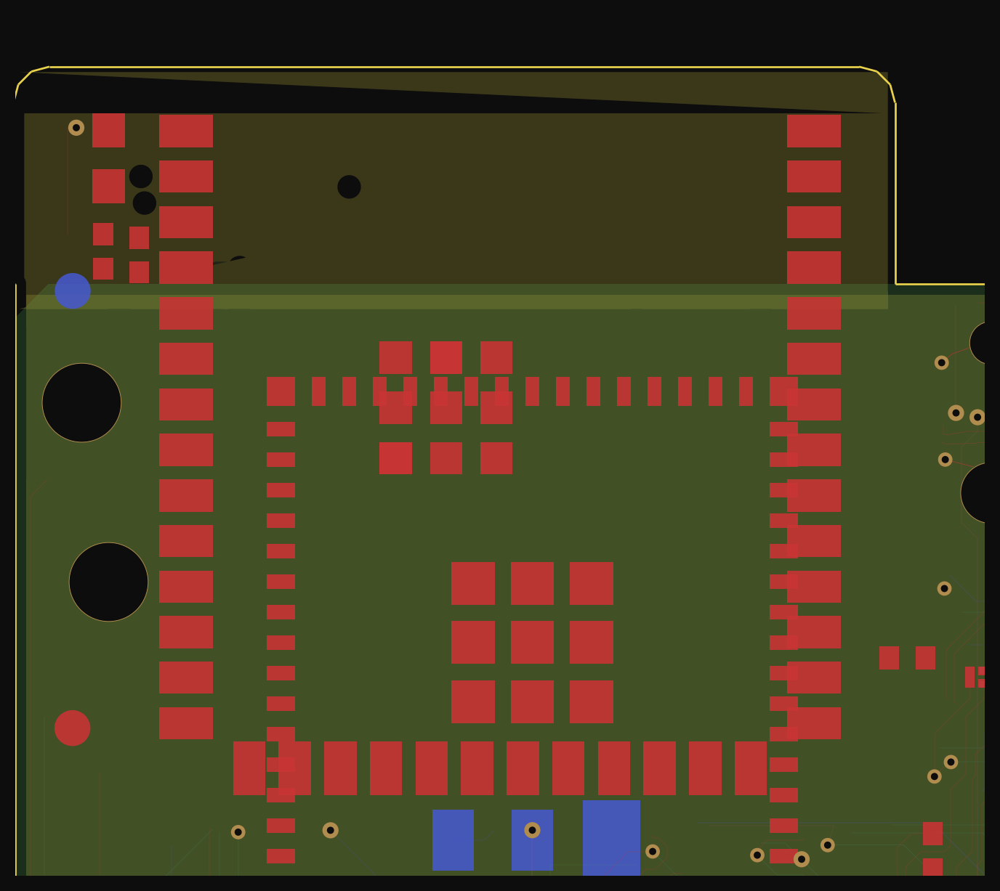
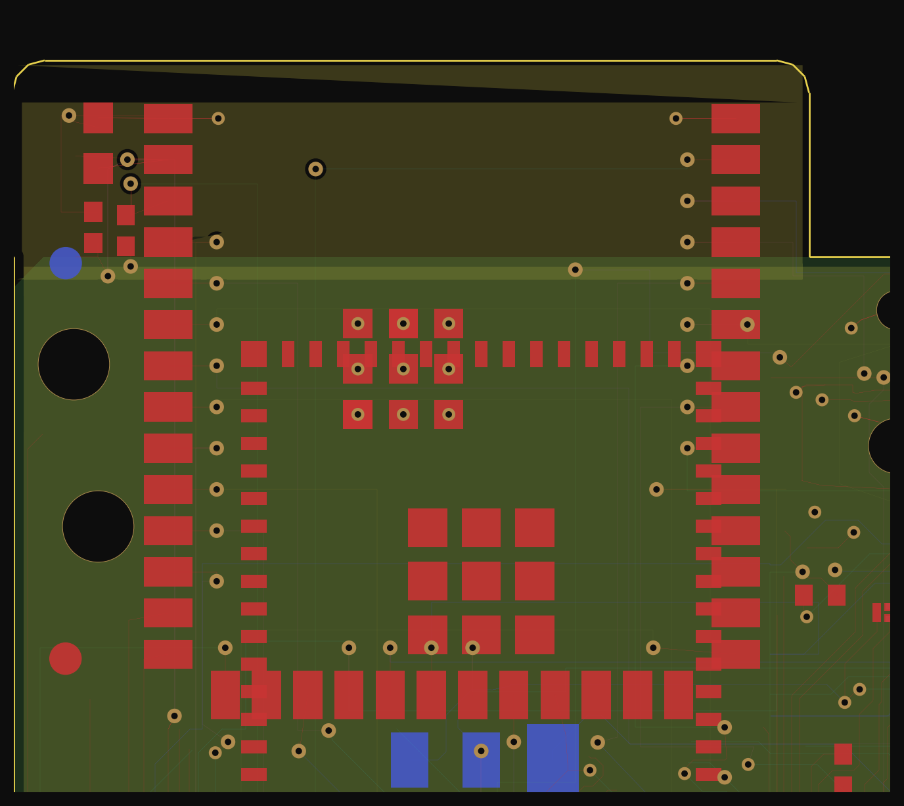

## 21st September - Riyansh D
1hr 30mins
##Initial product research on how to minimise space for sensors.

- the main issue was that the breakout boards for sensors take up to much space therefore to reduce the space used I decided to go for the ic versions of sensors
- This meant that I had to research each sensor I would be required to use and then its relevant ic component ensuring it does the same function in a smaller body without compromising on any data.
- Also I had to research and find which sellers near or around me would be able to sell theses components wether they were in wholesale or selling to hobbyists like me who only need a few rather than bulk
- lastly I just had a rough look at how the sensor structure would work as per the chosen sensors.
- This will all allow me to create a relatively small pcb and then ensure that the processing layer is all stacked on top of the sensing modality or on the other side of the board. 

Therefore the sensors I decide on for now are: 
#Optical / physiological
MAX86141 — HR/SpO₂ optical front end
AS7341-DLGM — spectral sensing
external optical emitters/detector where required by the MAX 
#Temperature
MLX90637 or MLX90632 
#Environmental
BME280 — temperature/humidity/pressure
BME680 only if we establish a reason for the gas channel
#Contact
FSR sensing element + simple PCB interface

*The lapse is a bit shorter than time I claimed to have worked as The recording stopped midway for some reason

## 22 september - Andre law
45 mins
## First variation of BOM

- The list of the first chosen sensors was looked at then researched as to wether they were the best chosen for their purpose or not
- After their functionality was confirmed I researched providers who were either local or had low shipping costs without compromising on time taken for delivery
- Then to narrow it down even further the shipping time and the overall product cost was added up get a rough idea of what providers are the best to choose.
- There is still lots of work which needs to be done to refine the spreadsheet and also the sheet will be updated many times according to the parts chosen or updated or even providers not being able to provide certain components in time or at a reasonable price therefore this will be updated frequently throughout the designing process and before the project is submitted for review.

 

----
## Moses Man - 28 Minutes
Merging custom repo 'Vital' into 'VitalQuant' Repo - it contains the new source code of the software in VitalQuant

---
## 24 September - Riyansh D
30 mins

- I had a short break in school in which I researched what sensors are best to use for the charging component as even the esp32 we will be using will be a circuit module therefore it will have no ports.
- The best way I found was using usb c and rechargable lipo batteries
- The components I chose to were:
  - MCP73831 : I went with this for the linear charge management controller as it a very small integrated circuit which is really easy to use.
  - XC6206P332MR: This LDO was chosen as it uses very low standby power whilst being extremely efficient.
  - TPS7A2: Addtionally this LDO was chosen aswell as it takes up very little space and is a 200-mA ultra-low quiescent
  - CP2102: finally this was chosen as esp32 modules lack built in usb programming hardware therefore a USB to UART bridge IC was required.
- Now I need to move on to creating the initial pcb schematic and finding footprints for all of these components so they can be wired and visually seen in the eventual CAD file for the case development.

----
## Moses - 26 Sept
3 hours
- Worked on the software and refactored the codebase to make it easier to debug issues when connecting with the software
- Installed and emulated a ESP32 to test firmware connectivity with our custom software
- Simulated test signals using the emulated ESP32 to test calibration of the software

----
## Moses - 30 Sept
3 hours
- Downloading datasets of sepsis patient data
- Manipulating datasets ready for training
- Post-trained a proprietary custom decision model (LAT-D-VQt-1) via LoRA FP16 using LatticeAG infrastructure - 8x A100 80gb GPUs
- https://latticeag.vercel.app/#/products/lat-d-vqt-1

---
## Riyansh - 30 sept
3 hrs 

- I spent time researching more components and I have now organised the pcb back side.
- I had recorded a lapse but this time was not recorded and there was some glitch where the lapse cannot be found (I have followed this up with hackclub)
- This took a lot of time as I had to ensure the research I had done was up to date with all the sensor research I had done.
- The new sensors were now organised only on the pcb and basic wiring was completed but this still needs to be heavily double checked and routing still has to be completed so lots of work will need to be put in to complete the pcb still.
- The BOM is all listed in the devin hw2_pcb branch
- This is just a very basic and initial render of the pcb

## Riyansh - 2 Oct
1hr 30 mins

- Between and school and other work I had to get some more time to basically fniallise what componanats were going to be used because this was just the intial desgin the one i had done on 30 sept.
- Turns out that there were many more upgrades that could be carried out which I had no idea about.
- A few listed ones being an onboard ecg and multiple other photo diodes
- I have listed the updated list in the main branch BOM list
- Andre should be creating a new updated list in the excel sheet with the new 80 parts

## Riyansh - 5 OCT
2 hrs

- started the first proper attempt at routing the pcb by hand today
- the board is really dense so i knew this was going to take a while so i began with the easier sections first
- got the usb c power input, the charge managment ic and the ldo section routed which was a good start
- also did the main power rails since those traces need to be a bit thicker anyway
- still loads of unrouted connections left, this is going to take a few sessions
*forgot to record a lapse for this one

## Riyansh - 7 OCT
1hr 27 mins

- I had free day yesterday which I spent on more pcb research and completetion
- carried on with the hand routing i started on the 5th, its taking way longer than expected because of how dense the board is
- finished off the rest of the power section and started working through the i2c and sensor connections
- the fine pitch ics are a pain to route around so progress is slow but its getting there
- still loads left unrouted so i will carry on when i get time

## Riyansh - 8 OCT
30 mins

- only had a bit of time today so it was a short routing session
- carried on hand routing the sensor connections on the back side of the board
- the optical sensor area is the hardest part because everything is packed in so tight so progress there was slow
- still got a fair few unrouted connections left, will continue when i get more time
*Lapse cutoff and lost

## Riyansh - 9 OCT
1hr 5mins
- more hand routing today, managed to get through a good chunk of it
- the unrouted connections are now down to about 45 which is progress but still annoying
- the main problem area is around the max86141 and the optical front end where the traces keep getting boxed in so i had to rip up and redo a few sections to open up space
- will hopefully finish it off tomorrow

## Riyansh - 10 OCT
1hr 13mins
- got the unrouted connections down from 45 to just 5 today which i was pretty suprised about
- ran DRC in kicad to figure out why the last 5 wouldnt route
- turns out the issue was the sensor island because it was very narrow and cutoff from the rest of the board so it was basicallly impossible to get traces into
- the reseason i had included the island ini the first place is because most biotech wearables have it for better heat dissipation from high voltage componants
- i realised that for this board that wasnt a issue and did not affectt funcitonality so i removed the island and routed the last few traces by hand
- only other thing flagged was the 3v3 rail which needs moving to 5v to supply more volts for the leds, will sort that tomorrow

## Riyansh - 11 OCT
30 mins
- finished off the last few traces this morning and moved the 3v3 rail over to 5v for the leds, drc finally came back clean so the board is fully routed now
- ran a quick simulation using our existing early detection python script and the hardware performed as expected.  
- There wasnt much to do today and I was busy with school work so i started with the initial case design
- the current design will host the pcb along with the lipo and then openings for each of the contact and skin facing sensors.
- So i just quickly mapped out the rough area and will carry on the rest when i get some free time.

## Riyansh - 12 OCT
1hr
- I had much more free time today so I spent that time refining the case
- the main issue was that previously the pcb wasn't fully developed so i was still unsure on sensor placement but now that all the componants were locked i could properly mount the pcb in the case and start building around it
- So now the main part of the case which had to be developed was the skin facing siide as thats where the optical and touch sensors siit therefore they need exact placement unlike the rest.
- I traced and initially sketched out a rough idea then transfered it to CAD along with a step file of the pcb
*There is some glitch with the screen recording so I have started recording myself using my phone as that works

## Riyansh - 13 OCT
1hr
- Now all that was left was to complete the rest of the case
- So to do that II wanted to make a easy fit desgin for the first prototype as this would be easier to test and work with
- I do have a heat set inserts but those are not required for a first prototype case and can be integrated into the next one because I will have to open and close the case many times
- So All the was left was to create a snap design for the top piece so it could fit with the bottom piece i designed yesterday.
- Then there was also the battery compartment which I left as a seperate and removable peice on the top of the case so that it could be removed and fit easily this also allows for better waterproofing.
- The water proofiing is just a concept but I have left grooves for like a simple tpu gasket.
Exploded render veiw in a graph style interface for size perception:

## Riyansh - 14 OCT
1hr 30 mins

- now that the case design was basically done i went back over the pcb routing to do a proper cleanup pass before it goes anywhere near fab
- straightened out some of the uglier traces, fixed a few awkward angles and added some extra via stitching on the ground
- also redid a small section near the mcu that was bugging me
- ran drc again after all of it and its still clean

## Riyansh - 15 OCT
45 mins

- final checks on the pcb today before i call it done
- cleaned up the silkscreen labels, double checked the mounting holes and board outline and generated the gerbers to make sure everything exports properly
- found a couple of small clearance issues which i fixed by hand
- pcb is fully done for now until i stress test it

## Riyansh - 18th OCT
1hr 30mins
- Ok so a lot of work has been done since the last entry
- The last entry contained the final 3d model render and now some issues came up when i stress tested the pcb
- The issues weren't that big but they were just mostly to do with the fact that there wasnt a surge protection for the battery and one of the 3v3 rails was missing a capcitor
- these were all relatively easy fixes so I went ahead and just updated the pcb and schematic.
- The main issue was ensuring the ecg worked this also meant pogo pins would have to be used to space the pcb but the issues was the least force availble was 0.4N and this had a too high combined force because the chest strap exerts a force of 3.3N and we needed pins for each optical sensor.
- Therefore I settled on conductive elastomer which is much easier to handle and better for a first prototype.
- Also the ecg was integrated into the circuit but there were no leads so 3 pads were added so that gel electrodes could be connected to the pcb to take readings.
- I also researched how blood pressure affected all of this because that was the main factor which the pcb could not have onboard so the mani options were pulse wave analysis which was more based on estimation though as compared to actually having a cuff
- This would also not be able to work effectivly because the werable is positioned close to the heart so it wouldnt be able to tke viable enough readings but could still be used
- the other option would be to use a bluetooth cuff which would be easier as the esp32 already has onboard bluetooth and wifi conntectivity

## Riyansh - 19 OCT
30 mins
- today i didn't have much time again so it was just a quick task to solve but the issue was that the 2 million parameter model that moses had created and trained would not have been able to run on the esp32 mini s3 module
- So this meant either offloading to another computer but also defeating the purpose of the model because the computer was already set to run a higher computational model
- This meant we had to switch to an ESP32-S3-WROOM-1-N16R8 this was because this had 8mb psram and would be able to run the model quite easily locally allowing us to process the sensor data and organise it onboard making the workflow much easier and more organised
- The issue now was that part of the board would have to be rerouted and reorganised so i ripped up the traces around the old module and started hand routing the new one
- luckily most of the board can stay as it is and its mainly the area around the module and the new psram and flash pins that need doing

## Riyansh - 20 OCT
1hr 30 mins

- spent today finishing off the re-routing around the new esp32 s3 module
- because the wroom module is bigger than the mini a few of the old traces had to be shuffled around and the psram and flash pins needed routing in
- got it all routed by hand and ran drc again with no errors left
- pcb is fully ready again so i can get back to sorting the case tomorrow
*didnt record a lapse for this one

## Riyansh - 21 OCT
1 hr
- School ended today so now i have much more time to focus on this project and get it ready for funding.
- Today i wanted to not spend to much time but also wanted to focus on getting the case ready for the final iteration
- The only changes that were required to be made were the extension of the case so the newer esp32 module could fit and the holes in the case for the wiring for the ecg electrodes and the lipo
- I also researched how heat disipation could be accuonted for because the new esp32 would be running the 2 million parameter locally so this would generate more heat
- as a result I added some vents around the case to allow for it to cool down and I would not have to worry about the battery anyways because that had its own external compartment anyways
- 

